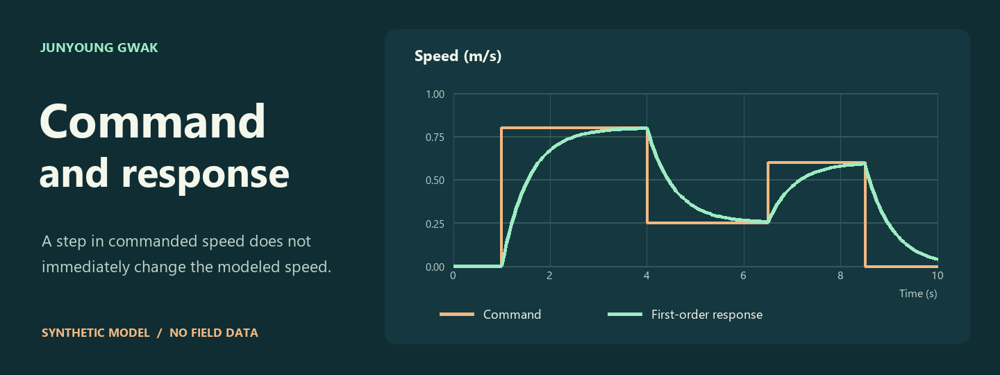

# 곽준영 · 자율주행과 로봇 소프트웨어

로봇이 멈추거나 예상과 다른 방향으로 움직였을 때, 센서 관측부터 최종 속도 명령까지 따라가며 원인을 좁히는 일을 해 왔습니다. ROS 2 기반 이동로봇의 주행·위치추정·시설 연동과 교육팀에서 담당한 작업 셀 통합을 정리했습니다.

**Junyoung Gwak** · Robotics software engineering · ROS 2 · Navigation · Perception · Integration

그림은 이 포트폴리오를 위해 만든 합성 예제입니다. [수식·입력·재현 방법](labs/control-response.md)

**실행 가능한 실험**　[경로 탐색 영상과 A*·Dijkstra 비교](labs/path-search.md)　·　[속도 응답 모델](labs/control-response.md)　·　[박스 IoU와 포함 비율](labs/box-overlap.md)

[미디어 출처와 실촬영본 추가 방법](media/README.md)

실험과 문서 링크는 Python 3.10·3.13에서 검사합니다. [GitHub Actions 실행 결과](https://github.com/Junyoung-Gwak/robotics-portfolio/actions/workflows/verify.yml)

| 관심 분야 | 먼저 읽을 사례 | 다룬 질문 |
| --- | --- | --- |
| 경로계획·주행제어 | [사람 추종과 순찰 제어](projects/navigation.md) | 화면에 보이는 경로와 실제 명령은 왜 달라졌나? |
| 위치추정·현장 검증 | [계단참의 층 판정](projects/localization.md) | 두 지도 후보 중 무엇이 현재 스캔을 더 잘 설명하나? |
| 인지·객체추적 | [검출 박스와 추적 ID](projects/perception.md) | 트랙이 늘어난 원인은 검출인가, 연결인가? |
| 로봇 시스템 통합 | [승강기 미션과 복구](projects/integration.md) | 시설의 허가와 로봇 동작의 완료를 어떻게 구분하나? |
| 시뮬레이션·공정자동화 | [물류 디지털 트윈과 협동 작업 셀](projects/robot-cells.md) | 여러 장치가 이어지는 작업에서 내가 맡은 경계는 어디였나? |

## 작업 시기

프로젝트를 수행한 시기와 이 문서를 정리한 시기를 구분했습니다. 일부 과거 과제는 개발을 마친 뒤 GitHub에 옮겼습니다.

| 수행 시기 | 주요 작업 |
| --- | --- |
| 2026.11 | 사람 추종 우회 경로와 명령 선택, 층간 위치추정 복구 및 사전 검사 |
| 2026.08–11 | 실외 순찰의 경유점 감속, 재접속 후 미션 상태, 승강기 승하차 연동 |
| 2026.06–07 | 시뮬레이터 카메라와 ROS 입력 점검, 중장비 영상의 검출·추적 비교 |
| 2026.01–03 | 레터링 로봇, 블록 조립 셀, 물류 디지털 트윈 팀 프로젝트 |
| 2022–23 | Gazebo 다기종 물류 팀 프로젝트 |
| 2019–21 | 연구실의 중앙제어 주차, 다중 UAV 협업 프로젝트 |

현장 사례는 장비·고객을 식별하는 세부 사항을 덜어내고 재현 조건과 기술 판단을 중심으로 정리했습니다. 팀 과제의 개인 담당은 당시 역할표를 기준으로 썼습니다. 문서와 설명 도해의 편집에는 Codex를 사용했습니다.
