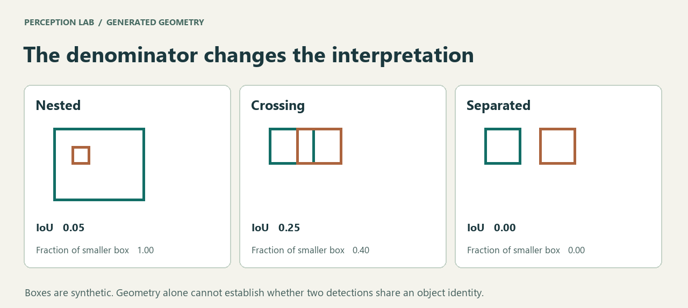

# 작은 박스가 완전히 포함돼도 IoU가 낮은 이유

[인지 프로젝트](../projects/perception.md) · [포트폴리오](../README.md)



**새로 제작한 합성 도해입니다.** 실제 영상이나 검출 결과 대신 좌표를 직접 정한 세 가지 입력을 사용했습니다.

두 축 정렬 박스 A, B의 교집합 면적을 I라고 하면 IoU는 `I / (area(A) + area(B) − I)`입니다. 작은 박스를 기준으로 한 비율은 `I / min(area(A), area(B))`입니다. 두 값의 분자는 같지만 답하는 질문이 다릅니다.

| 합성 입력 | IoU | 작은 박스 중 겹친 비율 | 해석 |
| --- | ---: | ---: | --- |
| 면적 4의 박스가 면적 80의 박스 안에 완전히 포함 | 0.05 | 1.00 | 높은 IoU 기준만으로는 작은 부분 박스가 남을 수 있음 |
| 면적 20인 박스 두 개가 면적 8만큼 겹침 | 0.25 | 0.40 | 둘 중 어느 쪽도 완전히 포함되지 않음 |
| 분리된 박스 | 0.00 | 0.00 | 양쪽 지표가 0 |

## 실제 추적 문제와의 연결

큰 트럭과 그 일부를 검출한 경우에는 포함 비율이 단서가 됩니다. 반대로 화면 안에서 앞뒤로 겹친 서로 다른 물체도 높은 포함 비율이 나올 수 있습니다. 이 계산만으로 박스를 무조건 합치면 새 오병합이 생깁니다. 클래스, 시간에 따른 움직임, 가림 뒤 정답 ID까지 비교해야 합니다.

이 예제는 ID를 추적하거나 성능 향상을 판정하지 않습니다. 두 기하 지표를 독립적으로 계산해 **어떤 입력을 사람이 다시 확인해야 하는지** 이해하기 위한 실험입니다.

```sh
python -m labs.box_overlap
python -m unittest discover -s tests -v
```

원본 시험은 완전 포함, 부분 겹침, 박스 순서 교환, 경계만 맞닿는 경우와 잘못된 좌표를 확인합니다.
