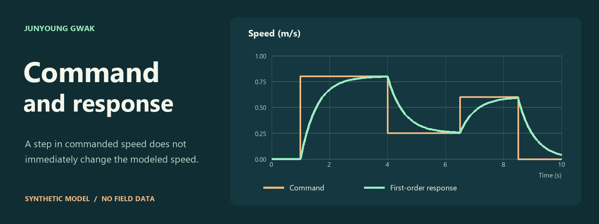

# 속도 명령과 차체 응답을 같은 시각에 비교하기

[프로젝트 기록](../projects/navigation.md) · [포트폴리오](../README.md)



**포트폴리오를 위해 만든 합성 그림입니다.** 실제 로봇의 주행 로그나 성능 측정값은 포함하지 않았습니다. 입력과 렌더링 스크립트를 함께 제공합니다.

## 질문

명령 속도가 0이 된 시각에도 odometry가 0보다 클 수 있습니다. 실제 로봇에서 이 차이를 해석하려면 타임스탬프, 후단 제한, 제동 동작을 확인해야 합니다. 여기서는 지연의 한 원인만 보기 위해 입력을 구간별 상수로 두고 1차 시스템을 계산합니다.

구간 안에서 명령이 일정할 때 모델은 `dv/dt = (u − v)/τ`이고, 정확한 한 구간 갱신은 `v_next = u + (v − u) · exp(−Δt/τ)`입니다. 입력이 0에서 1로 변한 뒤 한 시정수에서 속도는 최종 변화량의 약 63.2%에 도달합니다.

| 입력 | 이 예제에서의 설정 |
| --- | --- |
| 표본 간격 | 0.05 s |
| 시정수 τ | 0.55 s |
| 명령 전이 시각 | 1.0, 4.0, 6.5, 8.5 s |
| 출력 기록 | 각 시각의 명령과 그 구간을 시작할 때의 모델 속도 |

## 재현

저장소 루트에서 Python 3.10 이상으로 실행할 수 있습니다. 계산과 시험은 표준 라이브러리만 사용합니다.

```sh
python -m labs.control_response
python -m unittest discover -s tests -v
```

그래프를 다시 만들 때만 Pillow가 필요합니다. `python media/build_control.py`로 PNG를 갱신합니다. 실제 차체 지연이나 안전 정지 거리를 구하려면 독립적인 실제 시간 기준과 동기화한 측정 데이터가 필요합니다.
