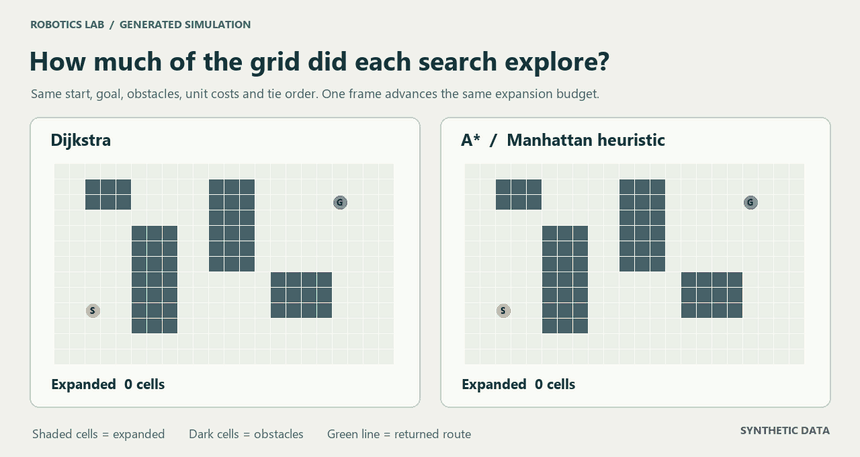

# 같은 길이의 경로를 찾을 때 어디까지 탐색하는가

[주차 프로젝트와 경로계획](../projects/navigation.md) · [포트폴리오](../README.md)



**새로 제작한 합성 시뮬레이션입니다.** 저장소의 Python 코드로 만든 예제이며 실제 주차 영상이나 현장 지도를 사용하지 않았습니다. [MP4](../media/grid-search.mp4) · [정지 화면](../media/grid-search.png) · [촬영본 추가 방법](../media/README.md)

## 같은 조건에 두 탐색기를 놓기

22 × 13 격자에서 상하좌우 이동 1회의 비용을 1로 둡니다. 장애물·시작·목표·이웃 방문 순서가 같고, 우선순위가 같으면 먼저 큐에 넣은 노드를 선택합니다. Dijkstra는 현재까지의 비용 `g`를 사용하고, A*는 `g + h`를 사용합니다. 이 예제의 `h`는 목표까지의 맨해튼 거리입니다.

장애물이 없어도 한 번의 이동으로 x 또는 y 중 한 좌표만 한 칸 바꿀 수 있습니다. 따라서 맨해튼 거리는 이 이동 규칙에서 실제 최소 비용의 하한입니다. 대각선이나 다른 비용 체계를 도입하면 휴리스틱의 전제도 다시 확인해야 합니다.

| 같은 입력에서 측정한 결과 | Dijkstra | A* |
| --- | ---: | ---: |
| 경로 비용(이동 횟수) | 27 | 27 |
| 확장한 칸(목표 포함) | 217 | 125 |

영상은 같은 수의 노드 확장을 한 프레임으로 묶었습니다. **재생 시간은 CPU 실행시간 측정치와 다릅니다.** 방문 수 차이는 이 장애물 배치와 동률 처리 규칙에 대한 결과입니다.

## 실패가 성공으로 보이지 않게 하기

시험에서는 시작과 목표가 같은 경우, 막힌 목표, 범위 밖 시작, 통로를 완전히 막은 장벽을 확인합니다. 도달할 수 없으면 빈 경로와 비용 `None`을 반환합니다. 성공 경로의 모든 연속 점이 실제로 연결된 이웃인지도 확인합니다.

이 예제는 점 로봇을 모델링합니다. 실제 차량에는 차체 윤곽, 최소 회전반경, 전·후진 전환, 속도 제약이 더 필요합니다. 예전 주차 프로젝트의 16방향 탐색 코드와 달리, 여기서는 휴리스틱의 효과만 분리할 수 있도록 4방향 교육용 구현을 새로 작성했습니다. [차량 운동학을 고려한 탐색의 원 논문](https://ai.stanford.edu/~ddolgov/dolgov08gppSTAIR.html)

```sh
python -m labs.grid_search
python -m unittest discover -s tests -v
```

시각화는 `python media/build_search.py`로 다시 만듭니다(Pillow 필요). MP4까지 만들 때는 `imageio-ffmpeg`를 설치하고 `--mp4`를 붙입니다.
